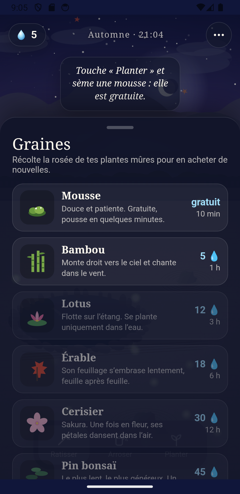

# Botaenica

Jeu mobile relaxant où l'on cultive et découvre un jardin botanique. Les plantes sont peintes, le rendu et l'ambiance sonore sont générés de façon procédurale.

<p>
  
  
  
</p>

## Fonctionnalités

- Collection d'espèces réelles à découvrir, avec des lieux qui se débloquent au fil des découvertes
- Quiz botanique quotidien qui rapporte de la rosée (avec un plafond par jour)
- Musique et sons générés à la volée (Web Audio), sans fichiers audio
- Interface multilingue (`src/i18n.js`)
- Mode démo : `?demo=1`

## Stack

Vanilla JS + [Vite](https://vitejs.dev) · [Capacitor 8](https://capacitorjs.com) (Android et iOS) · tests avec `node --test`

## Développement

```bash
npm install
npm run dev            # http://127.0.0.1:5190
npm test               # 16 tests
npm run android:sync
```

Pour iOS, il faut un Mac avec Xcode (voir `LISEZMOI-iPhone.txt`).

## Pipeline graphique

Les illustrations des plantes sont produites en local (ComfyUI + FLUX sur GPU) à partir de photos de référence sous licence libre (crédits dans `docs/credits-photos.json`), puis optimisées en WebP par les scripts de `scripts/`. Les sources brutes (1,8 Go) ne sont pas versionnées.

## Méthode de travail

Le jeu a été conçu et développé avec **Claude Code** : game design, logique testée, rendu procédural, pipeline d'images génératives et builds Android et iOS.
